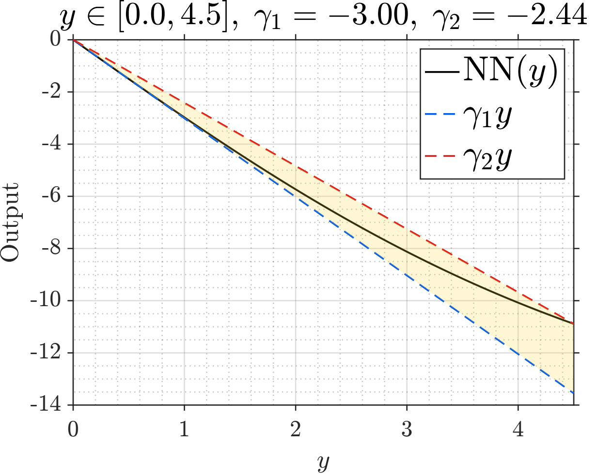
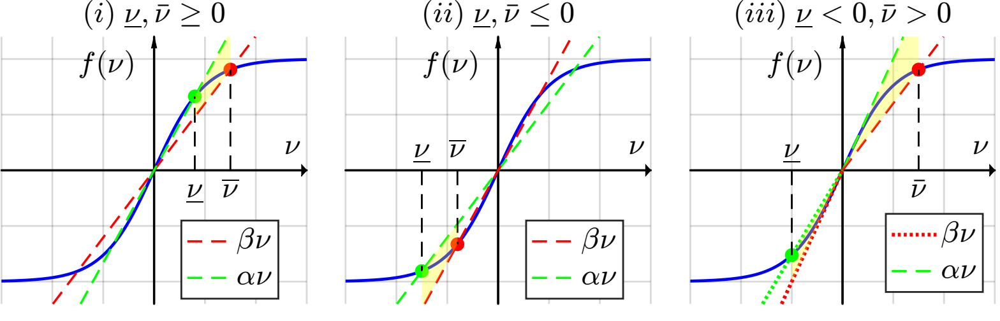
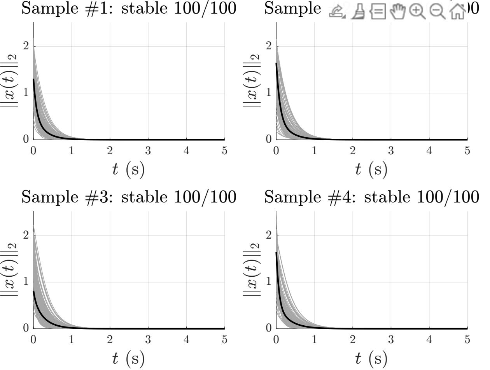
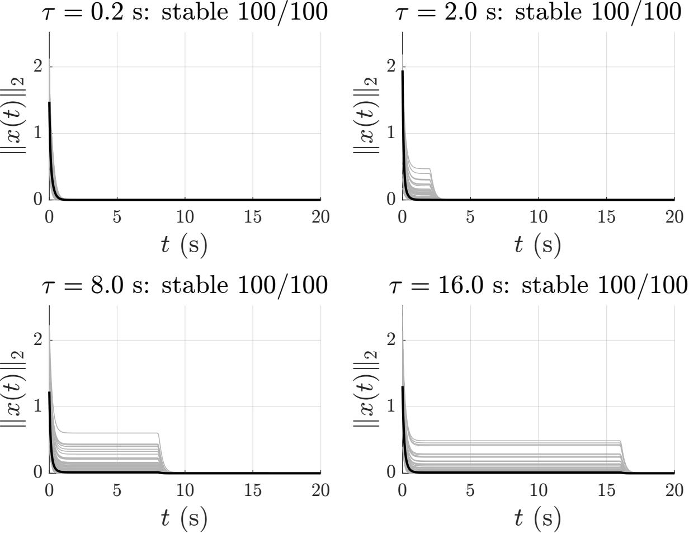

# Positive Lur'e Certificates for Risk-Aware NN-Controlled Systems

Code accompanying the paper

> H. Montazeri Hedesh and M. Siami,
> **"Delay Independent Safe Control with Neural Networks: Positive Lur'e Certificates for Risk Aware Autonomy,"**
> *2026 American Control Conference (ACC)*, New Orleans, LA, USA, 2026, pp. 134-141.
> [IEEE Xplore](https://ieeexplore.ieee.org/document/11616300) · [arXiv:2510.06661](https://arxiv.org/abs/2510.06661) (free preprint)

This repository certifies **local exponential stability** of a linear plant in feedback with a
**feedforward neural-network (NN) controller**, in the presence of two realistic risks:

1. **state/input time delays**, and
2. **interval-matrix (parametric) uncertainty**.

The NN is enclosed by a **network-level local sector bound** `[γ₁, γ₂]`, and the closed loop is
analyzed as a **positive Lur'e system**. This yields a **linear, delay-independent** certificate
(Metzler + Hurwitz tests) that runs orders of magnitude faster than the SDP/IQC baseline it is
benchmarked against, and certifies regimes where the IQC test cannot.

---

## Method at a glance

| Step | What it does | Code |
|------|--------------|------|
| **1. Local sector bound** (Thm 1) | Propagate a linear-in-`y` enclosure through the weights (`W⁺/W⁻`) and relax each `tanh` with per-neuron sector slopes, giving a single network-level `[γ₁, γ₂]`. | [`src/sector_bound_ffnn.m`](src/sector_bound_ffnn.m) |
| **2. Positivity certificate** (Thm 2–4) | Check that `A_lo + B·γ₁·C` is **Metzler** and `A_up + B·γ₂·C` is **Hurwitz**. If both hold, the loop is locally exponentially stable for **every** delay `τ ≥ 0` and **every** admissible interval. | [`src/certify_positive_lure.m`](src/certify_positive_lure.m) |
| **3. IQC/SDP baseline** (Sec. IV-C) | State-of-the-art IQC pipeline (delay + interval + NN local-sector IQC) solved as one LMI, used as a comparison point. | [`verification/verify_iqc.m`](verification/verify_iqc.m) |

The three risk configurations analyzed in the paper:

- **C1** — interval uncertainty, no delay (Theorem 2)
- **C2** — delay only (Theorem 3)
- **C3** — combined delay + interval (Theorem 4)

---

## The trained controller

A `1 → 10 → 10 → 1` `tanh`/`tanh`/`linear` network with **zero biases** (weights in [`data/`](data/)),
trained on trajectories of a PID-controlled system (training data in
[`data/training/`](data/training/)). It maps the scalar plant output `y = Cx` to the scalar input `u`.

Over the operating set `y ∈ [0, 4.5]` the sector bound gives **`γ₁ ≈ −3.01`, `γ₂ ≈ −2.44`**:

<p align="center"></p>

The three `tanh` sector-relaxation cases used by the bound (both-positive, both-negative,
sign-crossing):

<p align="center"></p>

---

## Results

**C1 — interval only.** Four random plants from the interval box, 100 random initial conditions
each; all decay to the origin, consistent with the Theorem 2 certificate
(Metzler margin `0.989`, Hurwitz max real eig `−0.26`).

<p align="center"></p>

**C2 — delay only.** The certificate is delay-independent, so a single test covers all delays.
Monte-Carlo for `τ ∈ {0.2, 2, 8, 16}` s confirms stability at every delay.

<p align="center"></p>

**C3 — combined delay + interval.** Five random `(A₀, A₁, τ)` systems, ten positive initial
histories each; all outputs contract to zero. (No pre-rendered image ships with the repo — run
[`examples/example_C3_combined.m`](examples/example_C3_combined.m) to generate it.)

**Runtime (Table I).** On this example the positivity certificate runs in `~5–6 × 10⁻⁵ s` and is
delay/discretization-independent, whereas the IQC baseline is configuration-dependent (fails to
certify at the coarse step) and up to `~10⁵×` slower at the fine step.

---

## Repository layout

```
positive-lure-nn-verification/
├── src/                          core method (reusable functions)
│   ├── nn_forward.m              FFNN forward pass  u = Phi(y)
│   ├── load_nn.m                 load the trained 1-10-10-1 network from data/
│   ├── preactivation_bounds.m    W+/W- interval propagation of W*x
│   ├── tanh_sector_slopes.m      per-neuron tanh sector slopes (3 cases)
│   ├── sector_bound_ffnn.m       Theorem 1: network-level [gamma1, gamma2]
│   └── certify_positive_lure.m   Theorems 2-4: Metzler + Hurwitz certificate
├── verification/
│   └── verify_iqc.m              Section IV-C IQC/SDP baseline (needs CVX)
├── examples/
│   ├── example_sector_bound.m    Fig. 3  (sector bound + plot)
│   ├── example_C1_interval.m     Fig. 4  (interval-only certificate + MC)
│   ├── example_C2_delay.m        Fig. 5  (delay-only certificate + MC)
│   ├── example_C3_combined.m     Fig. 6  (combined certificate + MC)
│   └── make_fig_tanh_sectors.m   Fig. 1  (tanh sector relaxations)
├── benchmarks/
│   ├── benchmark_positivity.m    Table I positivity runtime
│   └── benchmark_iqc.m           Table I IQC runtime (needs CVX)
├── utils/
│   └── simulate_delayed_lure.m   single-trajectory delayed-Lur'e simulator
├── data/
│   ├── W1.csv, W2.csv, W3.csv    trained NN weights (zero biases)
│   └── training/                 PID trajectories used to train the NN
└── assets/                       figures used in this README
```

---

## Getting started

**Requirements**
- MATLAB (R2020a+ recommended, for `exportgraphics`). Uses base MATLAB only — the DDE runs on the
  built-in `dde23`, ODEs on `ode45`.
- **Only** for the IQC baseline (`verify_iqc.m`, `benchmark_iqc.m`): [CVX](http://cvxr.com) with the
  **SeDuMi** solver.

**Run the positivity method (no toolboxes needed):**

```matlab
% from the repository root
addpath('src');
net = load_nn();

% network-level sector over the operating range
[g1, g2] = sector_bound_ffnn(net, 0, 4.5);      % ~ -3.01, -2.44

% delay-independent certificate for the interval box
A0L = [-8 2 1; 3 -10 2; 1 2 -8];  A0U = A0L + 0.5;
A1L = 3*ones(3);  A1U = 3.5*ones(3);
B = [1;1;1];  C = [1 1 1];
[pass, info] = certify_positive_lure(A0L+A1L, A0U+A1U, B, C, g1, g2);
% pass == true; info.metzler_margin, info.max_real_eig
```

**Reproduce the figures** — run any script in `examples/` (each is self-contained and adds the
needed paths; a PDF is written next to it):

```matlab
run examples/example_sector_bound.m     % Fig. 3
run examples/example_C1_interval.m      % Fig. 4
run examples/example_C2_delay.m         % Fig. 5
run examples/example_C3_combined.m      % Fig. 6
run examples/make_fig_tanh_sectors.m    % Fig. 1
```

**Reproduce the runtime comparison (Table I):**

```matlab
run benchmarks/benchmark_positivity.m   % ~5-6e-5 s, base MATLAB
run benchmarks/benchmark_iqc.m          % needs CVX + SeDuMi
```

---

## Notes

- The **certificate** assumes the positive-systems regime (`B, C ≥ 0`, and the operating set in the
  nonnegative orthant `y ∈ [0, 4.5]`). The **Monte-Carlo** scripts deliberately sample broader
  initial conditions (e.g. `[-1.5, 1.5]³`) to illustrate empirical behavior beyond the certified set;
  the combined case (C3) uses componentwise-positive histories as in the paper.
- `verify_iqc.m` is the paper's IQC formulation reorganized into a single function; the LMI is
  unchanged. It exists as a **baseline** — the positivity test in `certify_positive_lure.m` is the
  LMI-free, delay-independent method.
- Region-of-attraction analysis for the Γ-set is treated in the authors' companion work
  (arXiv:2505.22889) and is out of scope here.

## Citation

If you use this code, please cite the ACC 2026 paper. GitHub's "Cite this repository" button
(from [`CITATION.cff`](CITATION.cff)) gives the same reference in other formats.

```bibtex
@inproceedings{montazerihedesh2026delay,
  author        = {Montazeri Hedesh, Hamidreza and Siami, Milad},
  title         = {Delay Independent Safe Control with Neural Networks: Positive {Lur'e} Certificates for Risk Aware Autonomy},
  booktitle     = {2026 American Control Conference (ACC)},
  address       = {New Orleans, LA, USA},
  pages         = {134--141},
  year          = {2026},
  url           = {https://ieeexplore.ieee.org/document/11616300},
  eprint        = {2510.06661},
  archivePrefix = {arXiv},
  primaryClass  = {eess.SY}
}
```

## License

MIT — see [`LICENSE`](LICENSE).
